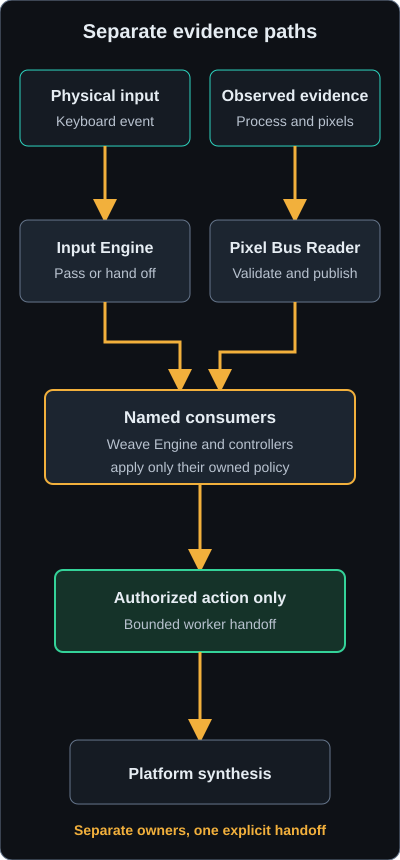

# Architecture and Ownership

ESO Weave is one Rust process composed of cooperating subsystems. The interface
owns presentation and configuration. Engines own correctness-bearing logic behind
test seams. Platform modules contain operating-system calls.

## Subsystem ownership

| Subsystem | Owns | Does not own |
| --- | --- | --- |
| Input Engine | Focus-scoped physical-event decisions, bindings, held-key bookkeeping, suspension, authorization epochs, shared synthesis gates, non-blocking handoff | Timed sequences and controller state |
| Game Observer | Installation candidates, process and launcher presence, focus, freshness, surface, and normalized Game Context | Pixel decoding and feature decisions |
| Weave Engine | Skill configuration, current timing, Global Cooldown, action sequences, and observable combat data | Physical hook callback and autonomous feature timers |
| Fishing Controller | Requested fishing state, detector events, deadlines, stop reasons, and Interact output | Pixel capture and hook decisions |
| Auto Potion Controller | Requested state, ordered eligibility rule, last attempt, and Quickslot output | Resource decoding and potion selection |
| Pixel Bus Reader | Layout negotiation, one-frame sampling, decoding, change detection, freshness, invalidation, and display description | User feature policy |
| Beacon Manager | AddOns discovery, ownership classification, embedded install files, managed in-place update and removal, block-size redeploy, and API-version upkeep | ESO runtime loading of the addon |
| Config and Session State | Separate user settings and derived runtime stores, notices, and serialization | Module-specific validation semantics |
| Logging | Global capture level, input suppression, bounded ring, and optional monthly file sink | UI presentation |
| Interface and App Model | Presentation, UI intent routing, persisted drafts, save scheduling, view projection, and one process-local stale HUD presentation snapshot | Platform input, screen capture, and action authorization from retained values |
| Documentation Service | Immutable embedded-site lookup, bounded loopback GET and HEAD responses, browser handoff, and worker lifetime | Filesystem serving, application state, remote content, and mutation |
| Local Extension Service | One opt-in authenticated loopback listener, discovery ownership, immutable player-state projection, bounded read-only database queries, HTTP and MCP adapter parity, and bounded shutdown | Remote clients, writes, agent orchestration, prompts, telemetry, or gameplay actions |
| Catalog Compiler and Runtime | Explicit normalized ingestion, provenance, coverage, semantic checksums, atomic publication, rollback evidence, and typed read-only queries | Startup generation, network discovery, user encounter storage, or UI-owned SQL |
| Catalog Candidate Pipeline | Maintainer-request validation, verified source acquisition, exact version tuples, compiler and icon-cache composition, thresholds, redacted reports, and immutable review candidates | Active selection, authenticated origin, releases, or source redistribution |
| Catalog Maintenance | Actual-root eligibility and independent optouts, stable complete input, compatible accumulation, verified immutable automatic activation, recovery and bounded retries | Source execution, arbitrary-file activation, PTS relabeling, game input or package-data mutation |
| Discovery Collector | Bounded automatic public-API enumeration, deterministic compatible Catalog records and natural save lifecycle | Package lifecycle, encounter state, input, networking or game art redistribution |
| Historical Encounter Readers | Compatible retained addon schemas, original evidence, normalization replay and declared loss | Loading or resuming the former recorder, desktop command ingress or gameplay authority |
| Encounter Ingest and Raw Store | Incremental normal/verbose v15 parsing with separate/inline ability facts, actual-root discovery, durable source progress, transactional completed fights, historical readers, immutable evidence and explicit contributor backup/deletion | Source mutation, game logger configuration, upload, input generation or gameplay authority |
| Encounter Metrics | Read-only raw and catalog joins, algorithm-versioned descriptive metrics, explicit loss quality, deterministic receipts, and atomic rebuildable JSON projections | Raw or catalog mutation, history UI, recommendations, live parity claims, upload, telemetry, or gameplay authority |
| Encounter Recommendations | Pure `s090-v1` evidence gates, bounded provisional review prompts, complete per-item provenance, and deterministic fact-to-advice separation | Raw or catalog mutation, network or model calls, telemetry, live parity claims, UI actions, or gameplay authority |

## Thread model

ESO Weave uses `std::thread`, `Arc<Mutex<...>>`, and `std::sync::mpsc`; it has no
async runtime.

| Thread | Receives | Owns or calls | Must not do |
| --- | --- | --- | --- |
| Main | UI events, queued application toggles, background API outcome | Interface, App Model, save scheduler, view state | Timed input sequences |
| Interception | Platform keyboard events | Focus refresh, `InputEngine::classify`, bounded handoff | Sleep, block, or synthesize |
| Weave worker | Actions from the bounded input channel | Application-toggle forwarding and `WeaveEngine::handle` through `RealSink` | Touch the interception callback |
| Pixel Bus worker | Clock deadlines, process probes, display and pixel samples | Game observations, safety pre-routing, controller routing, fishing ticks, Auto Potion ticks | Sample through another thread or treat stale data as current |
| API version check | Selected channel, historical cache, bounded history and revision-pinned documentation | Independent client/API evidence and persistent compatibility diagnostics | Delay the first window, guess an API, or expand package support from observations |
| Documentation worker | Bounded loopback requests after Help > Documentation is chosen | Exact embedded asset lookup and read-only HTTP responses | Read request-derived filesystem paths or access application state |

Five ownership contracts are load-bearing:

1. The interception callback never sleeps or blocks.
2. Every timed sequence runs on a worker.
3. Application hotkeys and on-screen controls converge on the same interface
   intent path.
4. Pixel-bus and interface deadlines use one monotonic clock origin.
5. Network version checking runs once in the background and never blocks startup.
6. Closing focus, suspension, or menu authorization advances an epoch observed by
   queued and running weave work; a stale epoch cannot resume after recovery.
7. Every PixelBeacon writer rechecks managed ownership at its write boundary.
8. Stale HUD retention clones rendered output only; controllers and input gates
   continue to consume current evidence and react to loss immediately.

Platform and hardware boundaries are represented by traits so engine, controller,
and decoder behavior can be tested with deterministic mocks.

## Data flow

<figure class="docs-flow-diagram">

</figure>

### Ownership flow text equivalent

Physical input remains on the input path: a platform keyboard event reaches the
focus-scoped Input Engine decision, then either passes to ESO or enters the
bounded action queue. Observed game evidence remains on the observation path:
process, focus, and displayed pixels reach the Pixel Bus Reader, which validates
and publishes observations. Named engines and controllers consume only their
owned inputs. The Weave Engine and feature controllers may combine a handed-off
request with current positive evidence, but platform synthesis follows only
after that consumer authorizes a bounded action.

Physical input follows this text sequence:

`platform event -> Input Engine decision -> pass to ESO OR suppress -> bounded action queue -> weave worker -> platform synthesis`

Game observation follows a separate sequence:

`process and focus probe + displayed pixels -> Pixel Bus Reader -> close unsafe atomic gates -> lock engines and controllers -> route current observations and subsystem consumers together -> feature ticks -> view model`

Game State stamps the first coherent-to-incoherent presentation transition with
the Pixel Bus worker's existing monotonic clock, including while the window is
not repainting. The view model may retain one coherent rendered player-state
snapshot against that timestamp and an original deadline cap. This happens after
the current loss has reached the safety path. The snapshot has no reverse edge
into Game State, the Weave Engine, Fishing, Auto Potion, or the Input Engine, and
process exit discards it.

Configuration follows:

`UI intent -> module validation and live application where implemented -> mark store dirty -> settle interval -> JSON write`

The stores are split deliberately. `config.json` contains user settings.
`state.json` contains suspend, Fishing, and Auto Potion intent, API-version
cache, and window geometry. Auto Potion effective state and evidence remain
runtime-only.

Logging follows:

`structured event -> global level and input-suppression filter -> bounded in-memory ring -> optional monthly file sink`

The Application Log reads the ring after its dropdown has applied and persisted the
global captured level used by both the ring and optional file sink.

Documentation follows a separate read-only path:

`Help action -> one application-owned 127.0.0.1 listener -> exact embedded asset lookup -> default browser`

Catalog data follows another read-only application path:

`reviewed normalized JSON -> explicit catalog-compiler command -> verified catalog.sqlite -> package path -> typed read-only application queries`

Maintainer candidate generation precedes package publication:

`pinned request -> bounded verified sources -> normalize/import -> build/verify/diff -> local icon receipt -> immutable review candidate`

Candidate generation cannot update the package path. Automatic maintenance verifies a completed compatible local source, accumulates accepted facts, publishes an immutable user-data generation, opens it read-only, then atomically selects it. A separate bounded coordinator owns eligibility/cancellation while one worker serializes builds. Invalid selection first resolves a retained verified generation, then a compatible packaged fallback. See [Automatic Catalog Maintenance](catalog-updates.md).

User-local API discovery precedes that path when explicitly requested:

`one combined PixelBeacon -> bounded automatic Catalog collection -> natural game save -> restricted importer -> compatible accumulated definitions`

Encounter ingestion has application-owned background authority:

`actual Live/PTS root -> bounded native discovery/read -> incremental parser -> completed fights and durable progress -> immutable encounter store -> background derived processing -> authenticated read-only local queries`

All four normal/verbose and separate/inline log version 15 combinations support
catchup and growing files. Partial tails
and unfinished fights wait; silence does not complete them. Source generations,
validated checkpoints and transactional commit admission prevent restart,
rotation, truncation or cancellation from mixing evidence. Native independent
facts require no Catalog; missing capabilities remain unavailable. Record-local
semantic decoding preserves exact source lines across profile changes and
checkpoint restoration without adding persisted format state.

Historical addon readers preserve raw schemas, normalization replay, ordinals,
loss, canonical bytes and hashes. The combined package does not load the old
recorder. These readers and contributor utilities are compatibility boundaries,
not a current player recording/import workflow.

Application-owned processing binds derived results to actual source, Catalog and
algorithm identities. Compatible Catalog changes invalidate applicable results;
unchanged inputs reuse results and stale work cannot replace a newer generation.
The pure recommendation domain consumes an immutable qualified projection; the
background service persists rebuildable results and receipts without selecting
an encounter or opening a window. No result authorizes gameplay input.

Icon lookup follows a separate local path:

`catalog virtual paths -> explicit user-owned directory -> bounded PNG/DDS decode -> immutable local manifest and objects`

The catalog never stores or associates user-local image bytes. The immutable
manifest is the explicit virtual-path-to-object authority, and every unavailable
source maps to the project placeholder. No icon path performs discovery,
download, archive extraction, upload, or application activation.

One managed PixelBeacon package owns independent beacon and automatic Catalog modules. Transactional migration validates exact owned inventory and preserves neighboring addons, SavedVariables and retained history. Capability recognition remains separate from mutation ownership. Its startup configuration carries the Catalog optout and actual installation channel; loaded Lua applies changes at the next natural load, without a live inbound command.

Catalog work and finalization yield within bounded ticks, automatically defer/resume around unsuitable game states and retain the last completed snapshot during failures. Both desktop data preferences persist independently, and both services are dormant without recognized compatible combined presence. Native processing consumes the same preference and actual-root eligibility contract through its independent bounded scheduler. Legacy addon encounter capture is not loaded or automatically resumed; its historical readers, exact evidence and loss semantics remain supported. Automatic native processing and downstream calculations continue with the former encounter viewer permanently removed.

Both importers parse the shared outer root through one crate-private restricted
table grammar, validate its schema and addon version, and then select only their
owned subtree. The catalog and encounter domains retain independent typed
schemas, bounds, and validation authority.

The compiler is a second binary in the existing Cargo package, not a `build.rs`
side effect or workspace. It builds a sibling candidate in one transaction,
validates and syncs it, preserves rollback evidence, then publishes atomically.
The application holds the opened version until a controlled reopen and degrades
to an empty typed catalog with a controlled diagnostic on verification failure.

Release-profile `build.rs` runs the pinned mdBook and link-check renderer, then
emits a sorted Rust manifest into Cargo's output directory. The executable
contains those bytes directly. Debug and test profiles use a small checked
fixture so ordinary Rust compilation does not require documentation tools. The
worker accepts only GET and HEAD, rejects ambiguous paths, never consults the
filesystem, and terminates with the interface owner.

## Ordering rules

Safety-closing Pixel Bus events update shared atomic gates before the worker waits
for controller locks. Safe recovery updates the owning engine or controller
before reopening interception. This asymmetric ordering prevents a recovered
physical key from being suppressed against stale worker state.

After the safety pre-route, every Pixel Bus worker branch sends each event through
one combined routing seam for current Game State and subsystem consumers. Live
configuration invalidations, safety-refresh invalidations, and sampled events
therefore cannot disagree about whether the current observation is coherent.

The input callback uses `try_send`, so overload never shifts work onto the hook
thread. The tradeoff is explicit: a full or disconnected queue drops the handed
off action after its physical event was suppressed and records a warning.

The App Model and Pixel Bus worker share one monotonic origin for fishing
deadlines. Wall-clock changes therefore cannot move an armed reel or recast
deadline. The App Model publishes complete scalar reader updates through a
standard-library channel. The worker's deadline wait wakes for an update, drains
rapid edits to the newest value, and applies one configuration boundary to both
decoding and cadence. Block geometry remains startup-owned because PixelBeacon
and screen capture must change together.

See [Action Authorization](../concepts/action-authorization.md) for the complete
gate comparison, [State Machines](state-machines.md) for transitions, and
[Test Strategy](test-strategy.md) for the evidence seams.
