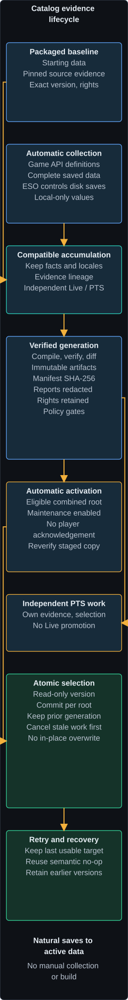

# Catalog Evidence and Candidate Pipeline

Automatic Catalog maintenance composes the bounded collector importer,
deterministic accumulation, compiler, verifier, semantic diff and immutable
activation. The existing maintainer pinned-source candidate builder uses the
same validation authorities. Candidate preparation and runtime selection remain
separate internal stages; the automatic coordinator completes both for eligible
installed contexts without a player-operated collection or review workflow.

## Catalog evidence lifecycle

The lifecycle traces natural game saves into verified active data. Read the
branches together with the adjacent text equivalent.

<figure class="docs-flow-diagram">

</figure>

### Catalog lifecycle text equivalent

1. **Alternative evidence inputs** include the actual packaged baseline and
   independently completed automatic collector generations. Pinned maintainer
   sources carry exact version, revision, hash and declared rights. The
   [bounded importer](discovery-collector.md) treats saved Lua as data, checks
   complete envelopes/chunks/provenance and retains source coverage. Natural ESO
   save timing controls disk availability; no player save or reload action is
   required. **Collector values remain local-only** under their declared rights.
2. **Compatible accumulation** keeps definitions, localized values and every
   supported relationship learned from different bounded scopes. Acquisition
   lineage and semantic coverage are separate. **Independent Live / PTS**
   contexts retain exact source/API/version identities; a narrower character
   view is not authority for global removal, and a semantic no-op does not churn
   active effective data.
3. **Verified generation** preparation compiles the accumulated data, verifies
   schema/integrity/semantic checksum, compares compatible coverage and enforces
   genuine removal and redistribution gates. Immutable candidate artifacts have
   canonical manifest SHA-256 identity. **Reports are redacted**, omitting raw
   captures, localized values, absolute paths and image bytes. Existing matching
   verified candidates can be reused. Virtual icon references remain distinct
   from separately cached binary images and release redistribution rights.
4. **Automatic activation** proceeds only for the matching recognized installed
   context while Catalog maintenance is requested. It rechecks eligibility,
   cancellation generation and staged integrity before selection. No player
   acknowledgement, collection/build/import command or review dialog is part of
   the automatic path. PTS work has its own evidence and selection; it never
   promotes into Live.
5. **Atomic selection** opens an immutable verified database read-only before
   committing the small per-context selection record. Consumers invalidate their
   old authority together. Cancellation before commit or validation failure
   preserves the last usable generation. The selection commit itself is
   non-interruptible; packaged bytes and open databases are never overwritten in
   place.
6. **Retry and recovery** retain the previous usable target and durable progress.
   Transient failures retry with bounded backoff. Restart reconciles completed
   evidence automatically; semantic replay reuses effective content. Disabling
   or losing the package cancels desktop scheduling and blocks stale activation,
   while retaining preferences, history and earlier immutable generations. The
   [automatic Catalog service](catalog-updates.md) owns this orchestration.

A maintainer pipeline-build command still creates an immutable candidate only.
The automatic coordinator explicitly performs the later verified selection
stage internally. These paths share integrity checks and preserve source rights.

## Request and source gates

Every request fixes the mode, Live or PTS channel, game version, API version,
catalog version and schema, locales, tool version, sources, baseline, and removal
thresholds. Input paths are workspace-relative. Local files are opened through
bounded no-follow handles and cached by exact SHA-256 without replacement.
Normalized source snapshots must match the acquired channel, version, locale,
revision, hash, license scope, and redistribution decision. Collector snapshots
retain the fixed local-only rights assigned by the restricted importer.

Remote acquisition is optional. The request and command must both enable it.
Only HTTPS raw content from the approved repository host at an immutable
40-character commit revision is admitted. Redirects are denied, reads have a
timeout and byte limit, and content is cached only after its declared SHA-256
matches. Refresh failure is fatal unless the request explicitly allows a
verified stale cache;
`sources.json` records that choice. Cold and warm non-refresh retrieval both use
the stable `pinned-remote` provenance value, so cache temperature cannot change
candidate identity. New source objects remain staged until the complete
candidate verifies and installs. Icon generations are built in the same run
staging area, then copied into the user-local cache only after installation.
An allowed stale-cache fallback also appears as a stable warning in
`validation.json`.

Live and PTS remain independent. The request, every applicable source, normalized
bundle, optional baseline, compiled catalog, and manifest must agree on channel.
There is no automatic PTS promotion.

## Candidate contract

`pipeline-build` writes exactly these review files:

- `catalog.sqlite`;
- `manifest.json` and `checksums.json`;
- `sources.json`, `validation.json`, and `diff.json`;
- `build-report.json` and `verify-report.json`; and
- `icons.json`.

Reports contain stable source identities, hashes, counts, and results. They omit
local paths, normalized source content, captures, localized catalog values, and
icon bytes. The candidate ID is the SHA-256 of its canonical manifest. Existing
candidates are verified and reused, never replaced.

Coverage completeness downgrades are explicit regressions and consume the same
configured threshold as removed coverage rows. Any localized-text redistribution
change blocks publication.

`pipeline-verify` checks the exact file allowlist, canonical manifest, artifact
sizes and hashes, directory identity, catalog integrity, channel, and semantic
checksum. Removal thresholds and baseline channel checks run before publication.

## Automation boundary

The pinned `catalog-candidate` workflow runs manually or on a schedule with
read-only repository permission and a 30 minute matrix-job timeout. It builds
and verifies invented Live and PTS candidates and uploads them for review. It
contains no repository write, installation, promotion, or release step. Automatic runtime activation and recovery are provided by the
[background Catalog service](catalog-updates.md). An arbitrary external candidate
does not become a discovered collector generation: its maintainer origin and
rights remain separate from the local automatic source contract.
