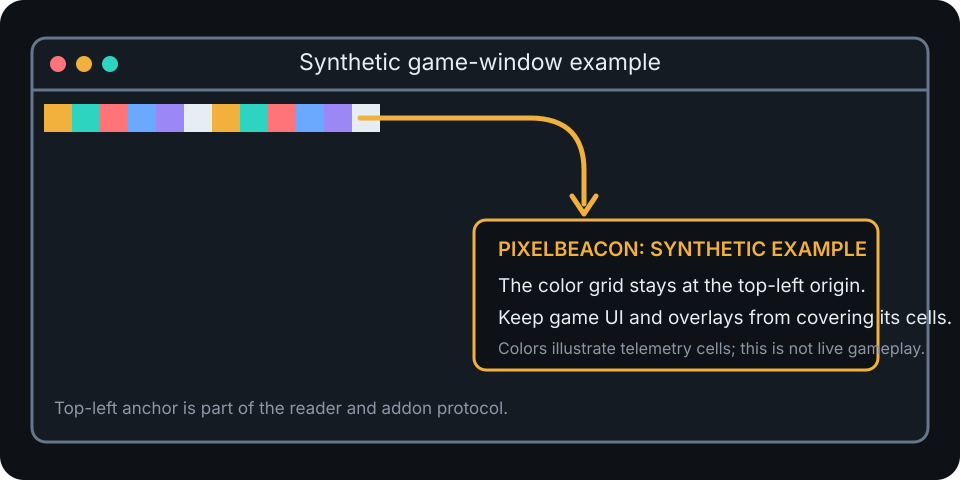

# PixelBeacon

PixelBeacon Status covers install addon, update addon, and unmanaged addon
states. API Version may appear as `APIVersion`, outdated addon, or ESO client
version in diagnostic discussions.

ESO exposes its Lua API to addons but provides no direct real-time subscription
for an external desktop application. PixelBeacon is the minimal bridge used by
ESO Weave. The single PixelBeacon addon renders solid-color telemetry blocks and
collects bounded local Catalog facts automatically. Its beacon and Catalog
modules have separate event and update namespaces. Catalog uses the existing
`EsoWeaveDataSaved` root; beacon signals do not depend on that saved state.

PixelBeacon is embedded in the ESO Weave binary and managed from System and
State. The overlay must remain visible at the top-left of the ESO client because
anything drawn over it can make the signal unavailable.

The addon is also described as the pixel addon, telemetry overlay, color blocks,
screen telemetry, or beacon. These terms refer to PixelBeacon and its Pixel Bus,
not to game memory or packet inspection.

At the default block size, protocol version 6 occupies 688 by 16 physical pixels
when one row fits: three layout-header cells and forty payload cells. PixelBeacon calculates
how many complete blocks fit the current client width. Lowering Block Size in
Settings reduces the footprint. A changed size is written when the addon is redeployed and takes effect in the
game at its next natural addon load. The desktop reader adopts the size on its
next start. ESO Weave does not force a reload, relog, or restart.

The overlay cannot be moved. Its origin is part of the shared protocol; changing
only one side would create an undetectable geometry disagreement.

The final eleven cells expose read-only native ESO bindings for Skill 1 through
5, Ultimate, Synergy, Attack, Block, Interact, and Quickslot. They distinguish
unavailable, unbound, conflicting, unsupported, and valid keyboard or mouse
chords. S100 makes this evidence available to the desktop but does not change
automation or remove existing settings. Those migrations remain in the next two
children of issue #188.

<figure class="docs-screenshot docs-screenshot--illustration">

<figcaption>Synthetic example, not live gameplay: PixelBeacon begins at the game client top-left origin, and other interface elements must not cover its cells.</figcaption>
</figure>

The colored cells in the illustration are explanatory only. The actual payload
varies with current telemetry, but its origin remains fixed and every cell must
stay unobscured.

## AddOns directory discovery

On Windows, ESO Weave resolves the Documents known folder through the shell API,
then locates `Elder Scrolls Online\<environment>\AddOns`. On Linux, it reads Steam
library metadata, finds app id `306130`, and resolves the path in the Proton
prefix. The `live` environment is the default and `pts` can be selected. A manual
override is also available.

In **Settings > PixelBeacon and Bus**, select **Live** or **PTS**. Use an
**AddOns Folder Override** only when discovery cannot find the existing
environment directory. The override must name the `AddOns` directory itself;
ESO Weave refuses to create a missing root.

Discovery never writes outside the resolved AddOns directory.

## Installation and update

One PixelBeacon installation supplies the beacon, startup configuration, isolated
bootstrap, and automatic Catalog module. The canonical inventory is
`PixelBeacon.txt`, `PixelBeacon.lua`, `StartupConfig.lua`,
`EsoWeaveData.lua`, and `Catalog.lua`. The manifest loads the beacon first so
optional data initialization cannot prevent beacon registration. It declares the
reviewed API support bundled with ESO Weave.

Managed legacy PixelBeacon, legacy ESO Weave Data, or both migrate automatically
to this package when their actual environment is discovered. No second addon
installation or manual file transfer is required. Neither package being present
does not cause an automatic installation. The ordinary PixelBeacon lifecycle
controls still install, update, and remove the complete package.

The on-disk package is classified as:

| State | Meaning |
| --- | --- |
| Not Installed | Neither a PixelBeacon target nor a recognized managed legacy Data package exists |
| Unmanaged | Ownership or the exact permitted inventory cannot be established |
| Installed (current) | The complete managed inventory matches the embedded package, rendered block size, and valid startup configuration |
| Installed (outdated) | A recognized managed package needs update, completion, or legacy migration |

Replacement is staged within the existing AddOns root. Retirement and commit use
no-replace directory moves, and snapshots are rechecked after retirement. A
precommit failure restores the previous entries without overwriting a raced
target. A bounded transaction receipt supports recovery after interruption.
Cleanup failure after commit is reported separately from replacement failure;
inspection continues to reflect the actual installed package. Unknown or changed
recovery files are preserved.

Management requires the ownership marker, declared inventory, regular files, and
bounded stable reads. Links, reparse points, unexpected files, and unproven
targets cannot grant permission to replace or delete files. Unrelated addons and
the other game's environment remain untouched. Removal preserves both the current
`SavedVariables/PixelBeacon.lua` and legacy `SavedVariables/EsoWeaveData.lua`,
completed Catalog data, legacy addon encounter data, and desktop history. The legacy Encounter recorder is not shipped or
automatically resumed by the combined package.

ESO derives the current saved filename from PixelBeacon.txt, not from the
EsoWeaveDataSaved global name. The new addon reads and saves PixelBeacon.lua; it
does not load the old EsoWeaveData.lua file. The desktop reads both Catalog files
independently and preserves compatible facts in its own accumulation. Legacy
encounter readers continue to use the old file. No game save is copied, rewritten,
or turned into an inbound command channel.

Package presence and mutation ownership are separate facts. A compatible manually
maintained combined package can make data controls available even when ESO Weave
cannot update or remove it. A beacon-only, partial, incompatible, or corrupt
package cannot make the background services eligible.

Disk changes do not replace Lua already loaded in ESO. New package files and the
Catalog startup preference take effect at the next natural addon load or game
session. No forced reload, gameplay action, or reload-required popup is involved.

<figure class="docs-screenshot">

<figcaption>Deterministic healthy baseline: the game and world are active, the combined PixelBeacon package is installed, and PixelBeacon Signal is detected.</figcaption>
</figure>

This deterministic fixture uses synthetic game observations and a temporary
combined package. Installed files do not establish that ESO has loaded them.

<figure class="docs-screenshot">

<figcaption>Deterministic unmanaged state: ownership cannot be proven, so ESO Weave offers no install, update, or removal action for that target.</figcaption>
</figure>

## Automatic data preferences

Settings provides two direct persistent controls: **Disable Catalog maintenance**
and **Disable native encounter log processing**. Both default to unchecked, and
each changes only its own preference. The controls retain their values while the
combined addon is absent and remain inactive when no compatible installation is
available. Live and PTS eligibility are evaluated independently of the environment
selected for ordinary lifecycle management.

Disabling Catalog maintenance stops desktop consumption and activation
immediately and retains the last usable Catalog. The package-owned
`StartupConfig.lua` carries the Catalog preference for the next natural addon
load; ESO's live SavedVariables are not used as an inbound command channel.
Already-loaded Lua cannot acknowledge a desktop preference immediately.
Re-enabling resumes eligible desktop work automatically. Native-processing
preferences have an independent eligibility and cancellation contract; the
incremental native watcher is delivered by the following work slice. Neither
preference changes beacon signals, gameplay features, or game-native logging.

## API version upkeep

The manifest carries the PixelBeacon package version, reviewed ESO addon API
declarations, and the managed marker. This build declares APIs 101051 and 101050.
The client release, addon API, Pixel Bus protocol, and package version are
different identities. A client patch can change without changing the addon API.

At startup, a background check reads up to eight recent commits for the selected
Live or PTS environment from published `esoui/esoui` UI sources. It finds the
numeric client release even when the head is a merge commit, then reads numeric
API documentation pinned to that exact revision. Each read is limited to five
seconds; stale, future-dated, malformed, or unavailable evidence remains unknown.
Sources older than 30 days cannot confirm current compatibility.
The check does not block startup on network failure.

The PixelBeacon status in System and State summarizes API compatibility for the combined companion package. **Game API** in **Data Details** provides the numeric evidence, separately from
installed package compatibility. An unsupported API requires an ESO Weave
update. An unknown check can be retried by checking the connection and restarting;
remembered unsupported observations retain their update guidance. A supported
bundled API does not prove that the installed addon is current or loaded.

Use **Update** for an outdated managed PixelBeacon. New files take effect at the
next natural addon load. Startup checks do not rewrite installed declarations or
turn an observed future API into a claim of support. Offline installation uses
the reviewed embedded declarations without requiring network access.

## Fishing signal and quickslot diagnostics

Fishing state is polled from ESO's interaction state every 100 ms. Bait
consumption while a cast is active is the sole bite signal. PixelBeacon does not
infer a bite from the standing interact prompt or a timer.

Run `/pbquickslot` in ESO for one bounded snapshot of quickslot facts. Run
`/pbquickslot watch` to report only changed snapshots, and run it again to stop.
The diagnostic intentionally omits localized item names and descriptions.
Quickslot classification first shipped in PixelBeacon version 13.

The commands are diagnostic tools, not setup requirements. Watch mode reports
only changed snapshots, and the same command stops it. If the heartbeat is not
healthy, first use [PixelBeacon signal troubleshooting](../getting-started/troubleshooting.md#pixelbeacon-signal-is-missing-or-lost).

## Overlay and compatibility recovery

Block Size choices are 2, 4, 8, 16, or 32 physical pixels, with 16 as the
default. A deployed change takes effect at the next natural addon load and the
next desktop reader start. Color
Tolerance and both sampling intervals apply live through a wakeable reader
update. Rapid edits coalesce to the newest complete value. Changing tolerance
closes cached menu, life, world, roll-dodge, and travel evidence before a fresh
sample can authorize generated input. Running Block Size and the internal
heartbeat timeout never enter that live update path.

Older layouts remain bounded to the fields they draw. Missing newer fields become
unavailable and are never guessed.

See [Pixel Bus Protocol](../reference/pixel-bus-protocol.md) for the wire contract.
