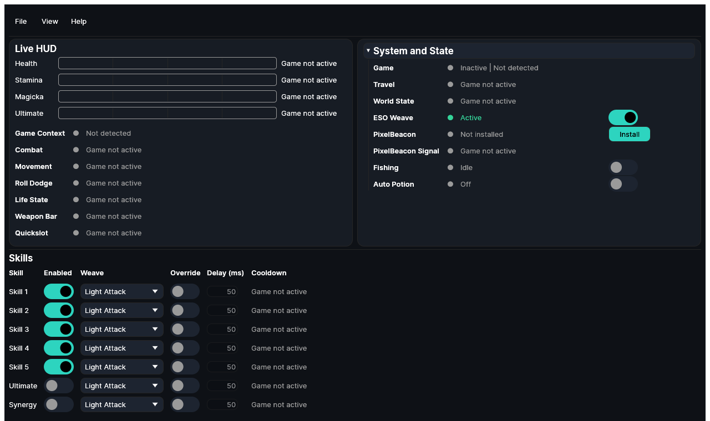
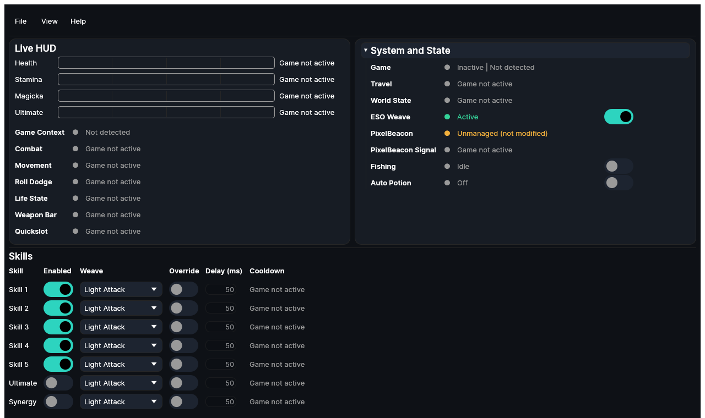
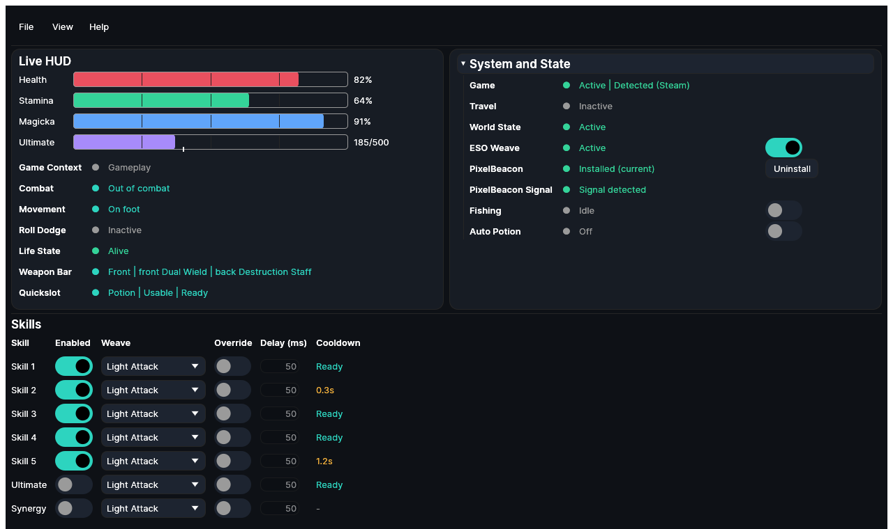
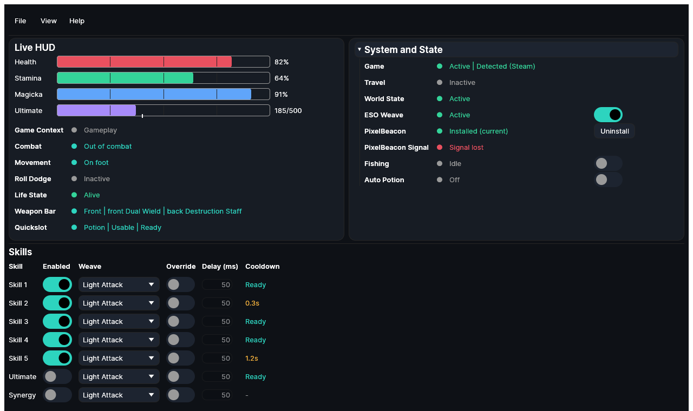

# First Launch

This walkthrough establishes a safe, observable baseline before any automation
is enabled. Keep ESO Weave visible beside ESO while completing the checks.

## 1. Confirm the desktop application

Launch ESO Weave from its installed shortcut or package. The window contains a
Live HUD, System and State, Skills, and an optional Application Log. **ESO Weave** should
show **Active** unless you intentionally suspended it.

<figure class="docs-screenshot">

<figcaption>Deterministic first-launch state: ESO is inactive, ESO Weave is active, and the single absent PixelBeacon package has one Install action.</figcaption>
</figure>

This deterministic screenshot uses synthetic observations and temporary addon
files. It does not show an installed game session.

Open **Settings** from the File menu and confirm the theme and platform-specific
options are usable. Changes are saved automatically. All Fishing controls and
the Pixel Bus tolerance and sampling intervals apply live. Only Pixel Bus Block
Size takes effect at the next natural addon load and desktop reader start; see
[Settings application timing](../reference/settings.md#application-timing).

## 2. Confirm ESO discovery

Start the ESO launcher and game. In **System and State**, the **Game** row combines
runtime and installation evidence. A normal installed game progresses from
**Launcher open** to **Active** and names one provider: ESO Store, Steam, Epic
Games, or Steam Proton.

If the row says **Not detected**, **Unknown**, or **Multiple installs detected**,
do not enable automation. Follow [Game discovery and runtime](troubleshooting.md#game-discovery-and-runtime).

## 3. Install PixelBeacon

PixelBeacon is the single bundled addon for the color-block telemetry overlay
and automatic Catalog collection.
In **System and State**, choose **Install** or **Update** beside **PixelBeacon
Status**. New Lua takes effect at the next natural addon load or game session;
ESO Weave does not force or prompt a reload.

At ESO's character selection, enable the PixelBeacon addon if the game has not
enabled it automatically. The small block overlay must remain visible at the
top-left of the game client. Do not cover that area with another window or
overlay.

If an existing PixelBeacon target was installed or edited outside ESO Weave,
System and State shows **Unmanaged (not modified)** and offers no lifecycle
buttons. Move or remove only that exact target manually before using **Install**.
ESO Weave does not overwrite an unproven target.

<figure class="docs-screenshot">

<figcaption>Deterministic unmanaged state: ownership cannot be proven, so ESO Weave offers no install, update, or removal action for that target.</figcaption>
</figure>

## 4. Automatic Catalog maintenance

A recognized managed legacy PixelBeacon or ESO Weave Data package migrates
automatically to the combined PixelBeacon package. No second addon installation
or manual file movement is required. Existing shared SavedVariables, legacy
encounter recordings, and imported desktop history remain readable. The combined
package does not resume the legacy addon encounter recorder.

Catalog collection and desktop maintenance request automatic operation by
default. No collector command, source selection, build, import, or refresh action
is required. ESO's normal save lifecycle determines when a completed snapshot is
available on disk. Desktop maintenance verifies and activates completed data in
the background while retaining the last usable Catalog through interruption.

The compact **Disable Catalog maintenance** and **Disable native encounter log
processing** controls persist independently. With no compatible combined addon,
both services remain dormant and both controls are inactive, retaining their
previous values. Disabling Catalog stops desktop maintenance immediately;
already-loaded Lua receives the startup preference at the next natural addon
load. No game reload is forced. Native-processing preferences supply the
independent contract for the native log service.

## 5. Verify fresh telemetry

Focus the ESO game window and enter the world. Wait for loading to finish. A
healthy baseline has:

| Field | Expected observation |
| --- | --- |
| Game | **Active** with the detected provider |
| World State | **Active** |
| PixelBeacon Status | **Installed (current)** |
| PixelBeacon Signal | **Signal detected** |
| Game Context | **Gameplay** when no native menu or chat field is open |
| Life State | **Alive** |
| Travel | **Inactive** |

Health, Stamina, Magicka, and Ultimate should become numeric when their current
protocol fields are available. A zero resource is a valid numeric reading;
**Signal unavailable**, **Not detected**, and **Unknown** are not zero.

<figure class="docs-screenshot">

<figcaption>Deterministic healthy baseline: the game and world are active, the combined PixelBeacon package is installed, and PixelBeacon Signal is detected.</figcaption>
</figure>
<figure class="docs-screenshot">

<figcaption>Deterministic lost-signal state: PixelBeacon remains installed, current input authority is unavailable, and retained HUD observations remain visible until recovery or expiry.</figcaption>
</figure>

These deterministic fixtures show current single-package management. Freshness
transitions are logged without adding a HUD row; retained observations remain
display-only while the signal is unavailable.

**Not installed** means the managed addon files are absent. **Signal lost** means
the addon is installed but the reader no longer sees a valid current frame.
**Signal detected** is the healthy state. These distinctions remain explicit in
the text even when the images are unavailable.

Open and close an ESO menu to confirm **Game Context** changes away from and back
to **Gameplay**. This is an observation test, not an invitation to automate.

## 6. Configure one feature

Start with only one feature:

- [Configure one weaving slot](../features/weaving.md#configure-one-slot).
- [Prepare and start Fishing](../features/fishing.md#before-starting).
- [Configure Auto Potion](../features/auto-potion.md#configure-auto-potion).

Fishing and Auto Potion requests are remembered across normal restarts. A
restored request cannot generate input until current runtime and feature-specific
safety evidence is available.

Use the [Status Reference](../reference/status-reference.md) for exact meanings.
If the expected baseline does not appear, continue to
[Troubleshooting](troubleshooting.md) before enabling input generation.
