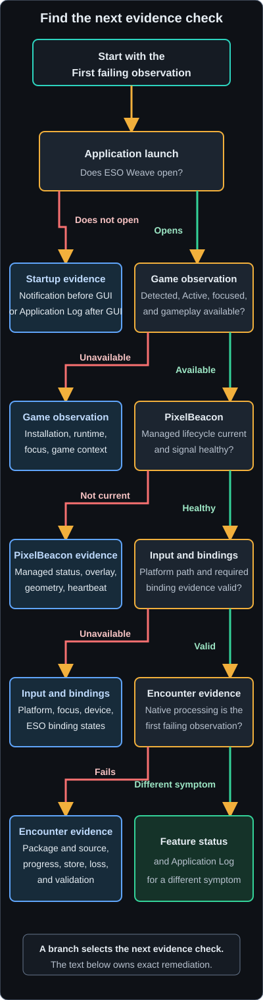

# Troubleshooting

Signal Lost may be described as a missing beacon, heartbeat timeout, or hidden
overlay. Start with the shared diagnostic flow below for any of those reports.

Start with the first failing observation, then follow the matching branch. Do not
disable focus checks, signal validation, suspension, or managed-addon guards to
make automation run.

For the optional authenticated extension service, including a stopped listener,
port collision, stale discovery, bearer rejection, protocol mismatch, database
limits, or client disconnect, use [Local API and MCP
troubleshooting](../reference/local-api-and-mcp.md#troubleshooting).

## Shared diagnostic flow

<figure class="docs-flow-diagram">



</figure>

### Shared diagnostic flow text equivalent

```text
Does ESO Weave open?
  No -> inspect Startup failure evidence before or after GUI initialization.
  Yes -> is ESO detected and Active?
    No -> fix installation or runtime discovery.
    Yes -> is the ESO window focused and Game Context Gameplay?
      No -> focus ESO, close menus, or wait for fresh lifecycle evidence.
      Yes -> is PixelBeacon Installed (current)?
        No -> fix addon discovery or lifecycle state.
        Yes -> is PixelBeacon Signal detected?
          No -> check addon enablement, reload, overlay visibility, and geometry.
          Yes -> are the platform input path and native binding evidence valid?
            No -> is native binding evidence Unavailable?
              Yes -> update or reload PixelBeacon and restore the shared signal first.
              No -> use the platform input guidance and native binding state table.
            Yes -> is automatic encounter processing the first failing observation?
              Yes -> inspect package eligibility, source generation, progress, store, and loss.
              No -> inspect the feature-specific status and Application Log.
```

The indented text is the complete decision tree. Each matching failure branch
stops before feature-specific diagnosis because later observations depend on
the earlier one.

## Game discovery and runtime

| Symptom | Meaning | Next action |
| --- | --- | --- |
| **Not detected** | No validated ESO installation or active game was found | Confirm ESO is installed for the current user and launch it normally |
| **Multiple installs detected** | More than one authoritative installation root conflicts | Close ESO Weave, identify the intended installation, and use the AddOns folder override only for PixelBeacon while provider ambiguity remains visible |
| **Unknown** | The operating-system observation did not authorize a conclusion | Retry after the launcher and game settle; inspect the Application Log if it persists |
| **Launcher open** | The launcher is present but the game client is not active | Start the game client |
| **Inactive** | The launcher and game client are absent | Start ESO |

Game exit clears game-derived observations and held-key state. Returning to the
game requires fresh focus, heartbeat, surface, life, world, travel, and roll
evidence. Dropped work is not replayed.

## Linux input or focus does not work

1. Confirm the current user has either `input` group membership or the packaged
   `/dev/uinput` udev rule described in [Installation](installation.md#linux).
2. If group membership changed, sign out and back in.
3. Confirm ESO runs under X11 or XWayland. Pure Wayland cannot provide the active
   X window and capture evidence required by the current application.
4. Confirm the physical keyboard exposes the expected keys and no other program
   has exclusively grabbed it.
5. Inspect the Application Log for an explicit pass-through emission error.

Do not use recursive permission changes or world-writable device modes.

## PixelBeacon is not current

| Visible state | Next action |
| --- | --- |
| **Not installed** | Choose **Install**, then `/reloadui` or relog if ESO is running |
| **Installed (outdated)** | Choose **Update** to replace the managed copy in place; then reload ESO |
| **Unmanaged (not modified)** | No lifecycle action is offered; move or remove only that exact target manually, then install a managed copy |
| **AddOns folder not found** | In Settings, select Live or PTS correctly, or enter the existing environment's `AddOns` directory as the override |

An existing PixelBeacon target whose ownership cannot be proven is shown as
**Unmanaged (not modified)**. Install, Update, Uninstall, API refresh, and
block-size redeploy refuse it without changing its contents. Resolve only that
exact target manually; do not disable the ownership guard.

## PixelBeacon Signal is missing or lost

1. Confirm PixelBeacon is enabled in ESO's addon list.
2. Run `/reloadui` or relog after install, update, or removal.
3. Keep the top-left color-block overlay visible and unobstructed.
4. If Block Size changed, redeploy the managed addon, reload ESO, and restart ESO
   Weave so both sides use the same physical geometry.
5. Wait until loading ends and **World State** returns to **Active**.
6. Use [PixelBeacon quickslot diagnostics](../features/pixelbeacon.md#fishing-signal-and-quickslot-diagnostics)
   only after the shared signal is healthy.

Missing, invalid, stale, or corrupt telemetry becomes unavailable and does not
authorize automated input.

The Live HUD may continue showing the last coherent values after a loss. Check
the logs for loss, cause changes, expiry, and recovery. No temporary notification
appears above the gauges. These values are
display-only and do not keep weaving, Fishing, or Auto Potion authorized. Fresh
observations replace them immediately; the configured **Stale Retention
(seconds)** interval then expires to the ordinary unavailable view. Set it to 0
under Appearance when immediate clearing is preferred.

## Native binding evidence is unavailable

PixelBeacon discovers bindings without changing ESO controls. Weaving, Fishing,
and Auto Potion consume their current action subset without a desktop fallback.
The evidence distinguishes these states for each native ESO action:

| State | Meaning | Safe next action |
| --- | --- | --- |
| Unavailable | PixelBeacon is old, the signal is stale or malformed, or ESO has not loaded binding data | Update PixelBeacon, reload ESO, and restore the shared signal first |
| Unbound | ESO has no keyboard or mouse assignment for the action | Bind the action in ESO's Controls menu |
| Conflicting | More than one distinct desktop assignment exists | Leave one intended keyboard or mouse chord in ESO |
| Unsupported | The only assignment is gamepad, combined, hold, unknown, or otherwise outside the portable registry | Choose an ordinary keyboard key or supported mouse control in ESO |
| Valid | One supported primary and normalized modifier set was decoded | The corresponding weave, Fishing, or Auto Potion action is usable now |

Do not install a custom binding addon or edit `Bindings.xml` to repair evidence.
PixelBeacon uses only ESO's read-only runtime binding APIs and deliberately has no
binding mutation or persistence path.

Keyboard or mouse bindings can coexist with positively identified controller
bindings. Controller bindings do not create desktop conflicts. Controller-only
actions remain unsupported; unrecognized device evidence does not authorize a
guessed desktop control. Update PixelBeacon and reload ESO to receive this
discovery repair.

If valid combat evidence still passes through, confirm the skill row is enabled
and required Attack or Block evidence is also valid. Release extra physical
modifiers that are absent from a target chord. ESO Weave refuses to synthesize a
release for a modifier you are holding.

If Fishing or Auto Potion reports a binding unavailable state, inspect the
read-only detected row in Settings, repair the action in ESO, and reload the UI.
Do not add the obsolete gameplay key back to `config.json` because it is ignored.

## Automatic data services are dormant or deferred

Catalog maintenance and native encounter-log processing use the single combined
PixelBeacon package. There is no separate Data installation or repair action.
Check the PixelBeacon lifecycle state above and the selected Live or PTS AddOns
root. A compatible manual combined package is recognized; an unknown or partial
package does not start data work. Do not edit ownership markers to make it eligible.

In Settings, check **Disable Catalog maintenance** and **Disable native encounter
log processing** independently. Both preferences persist globally. An absent or
unrecognized combined addon leaves these services dormant. Desktop Catalog work
stops immediately when disabled; the addon preference applies at the **next natural
addon load**. No Catalog command, reload, or save action is required to apply the
desktop preference. Enablement, loaded state, current activity, and the last saved
file are different observations; a disk file does not prove runtime activity.

If a newer game API is unsupported, use an ESO Weave release that declares support.
An unknown or failed API check cannot prove compatibility. Live and PTS keep
separate API evidence, package roots, and Catalog generations.

## Automatic native processing is waiting or unavailable

Native processing discovers actual Live/PTS sources and follows supported
normal/separate version 15 records automatically. An absent file, quiet logger,
incomplete line or unfinished fight can be an ordinary waiting state. A stale file
does not prove current logging activity. ESO owns logging and serialization;
the desktop does not toggle them.

Check the combined package eligibility and **Disable native encounter log
processing** preference. A transient sharing, access or database failure retries
with bounded backoff. Controlled Application Log categories distinguish source,
format, checkpoint and store failures without exposing raw values. Existing
completed fights remain readable through the local API/MCP regardless of service
eligibility. No source inspection, manual import or replacement viewer is needed.

Normal/inline remains [#296](https://github.com/h8rt3rmin8r/eso-weave/issues/296),
and verbose remains [#297](https://github.com/h8rt3rmin8r/eso-weave/issues/297).
Unsupported saved-data version, malformed same-version data, source identity
conflicts and corrupt stores are preserved. Do not edit version fields or hashes
to bypass validation. Missing compatible definitions leave qualified historical
calculations unavailable; native independent facts do not require a Catalog.
**Incomplete observations** and unknown evidence retain their declared limits,
and missing duration remains an unavailable rate rather than zero. Restart and
retry reuse committed progress without duplicates or source mutation.

## Automatic Catalog collection is deferred or fails

Catalog collection starts and resumes automatically after valid addon and player
readiness, outside combat and unsafe lifecycle states. Combat, loading, or a
temporary source failure defers work. There is no manual start or resume command.
Check the combined PixelBeacon package, the selected Live or PTS context, the
Catalog preference, and controlled Application Log diagnostics.

A failed scan or finalization retains the previous completed Catalog snapshot.
Unknown saved roots are preserved and are not rewritten as a guessed schema.
ESO controls SavedVariables disk writes; a priority-save request does not prove
that a file was flushed. Automatic desktop observation waits for a stable, complete
file and retries transient failures with backoff. No reload, observe-save, import,
or build action is required for Catalog maintenance.

Channel, API, checksum, chunk, status, size, and schema failures leave prior usable
evidence in place. Preserve the source for diagnosis and use compatible package
and application versions; do not edit hashes or version fields to bypass checks.
See [Automatic Catalog Collection](../development/discovery-collector.md).

## A local ability icon uses the placeholder

S072 provides a library cache boundary but does not activate icon selection in
the application. For direct library use, confirm that the explicitly selected
source root mirrors the complete catalog virtual path and contains a PNG or DDS
file. `Missing` and `Unsupported` identify absence or file type. `Failed`
includes unsafe paths, links or reparse points, permissions, corruption,
dimension or byte limits, and cache integrity failures.

Do not move game image bytes into the repository or a release to repair a local
lookup. Keep them in the user-owned source and application-data cache. Remove or
replace only the exact failed local cache generation after preserving it for
diagnosis; another verified immutable generation remains usable.

## A catalog review candidate fails

Candidate generation is a maintainer operation and does not affect the catalog
used by the application. Read `validation.json`, `sources.json`, and the command
error before retrying. Fix the pinned request or source rather than changing a
hash to bypass verification. A failed source refresh uses cached bytes only when
the request explicitly permits stale fallback, and the resulting source report
labels that choice. Existing immutable candidates remain unchanged.

## Automatic Catalog activation or recovery fails

Automatic maintenance accumulates compatible evidence by exact Live or PTS
context and API identity, builds an immutable generation, verifies it, and changes
the active selection atomically. A stable unchanged capture is a no-op. Missing,
unstable, malformed, wrong-channel, unsupported, checksum-invalid, or policy-invalid
data leaves the last-known-good Catalog active. Read the controlled Application
Log stage and reason; do not edit manifests or checksums to bypass verification.

Transient observation and build failures retry with backoff. Disabling Catalog
maintenance or losing compatible addon availability stops pending activation.
Restart recovery discards abandoned staging while preserving verified generations;
an invalid persisted selection falls back to usable verified data or the packaged
baseline. Live and PTS remain independent, including when no usable generation is
available for one context. See [Automatic Catalog Maintenance](../development/catalog-updates.md).

## A skill passes through or a weave is dropped

Check the Skills row first. It must be enabled, bound to the physical key, and
outside the configured Global Cooldown. Then confirm ESO is active and focused,
ESO Weave is not suspended, Game Context is **Gameplay**, Life State is **Alive**,
World State is **Active**, Travel is **Inactive**, and Roll Dodge is **Inactive**.

A blocked physical skill passes through where the input gate can decide safely.
A request dropped after queueing is not replayed. Focus loss, suspension, or
menu-gate closure invalidates the authorization epoch for queued and running
work. Any output already held is released, but no new generated press follows
the closure.

## Fishing returns to Idle

Use the exact suffix:

- **no cast detected**: select bait, face the fishing-hole prompt, and start with
  `F2` rather than casting manually.
- **signal lost**: restore the PixelBeacon heartbeat before starting again.
- **game not active** or **game unfocused**: return to an active, focused ESO
  window. With the other safety gates clear, the retained request automatically
  attempts a fresh cast.
- **player unavailable**, **world unavailable**, or **travel pending**: wait for
  Alive, Active, and Inactive evidence, then make a fresh start as described on
  the [Fishing page](../features/fishing.md#status-meanings).

## Auto Potion is Dormant or Blocked

The Auto Potion line names the first current blocker. Use the
[Auto Potion state table](../features/auto-potion.md#status-and-recovery) in order.
The request remains on through ordinary dormant and blocked states and across a
normal application restart. After restart, wait for fresh current evidence;
remembered enablement does not make a missing or stale gate permissive.

## Configuration was rejected

Invalid `config.json` content falls back to safe defaults and the rejected file
is preserved with an `.invalid` suffix. Do not repeatedly edit or delete files
while ESO Weave is running. Close the application, preserve the rejected file for
diagnosis, then change only the exact invalid field or allow a fresh default file
to be written. Session-state load failures use safe defaults but do not have the
same `.invalid` preservation guarantee.

## Use the Application Log

Open **View > Application Log**. Select INFO for ordinary lifecycle diagnosis, DEBUG for
a bounded reproduction, or TRACE only when resource sampling detail is needed.
The dropdown changes and persists the global captured level for both the Application Log
ring and optional file logging.

Enable **Write Log to File** before reproducing a problem that must survive the
current session. See [Logging](../reference/logging.md) for paths and privacy.

## Startup failure

After logging initializes, a panic is written to the application log. A very
early panic may occur before that best-effort initialization. Before the GUI
event loop starts, the application surfaces the failure to the user: Windows shows a native
**ESO Weave failed to start** dialog, while Linux writes the same notice to
standard error. After the GUI starts, later panics use the initialized log only so an unexpected
dialog cannot interrupt play.

Record the exact dialog or terminal text, package and version, operating system,
and whether a monthly log was created. Re-verify the package checksum, then report
the evidence without including private paths or unrelated log data.
