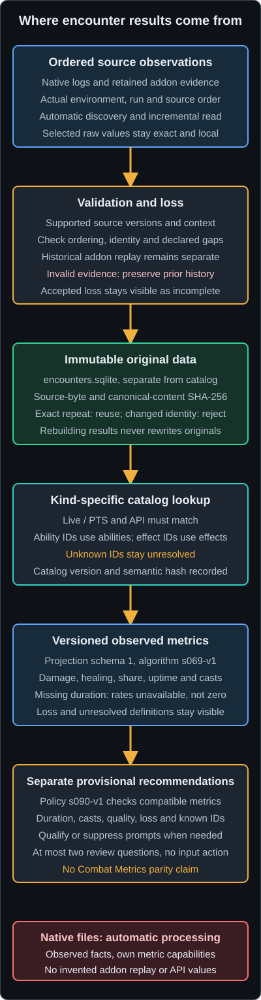

# Encounter Data and Metrics

The user-owned encounter database preserves historical addon and native evidence.
Application services acquire supported native fights and calculate available
results automatically. The optional authenticated read-only local API/MCP exposes
stored data without a desktop encounter viewer. See [Encounter
Capture](../features/encounter-capture.md) and [Encounter
Ingestion](../development/encounter-ingestion.md).

**Catalog** means game-data definitions for recorded IDs, separate from fights.
**SavedVariables** means the game's saved addon data. Application Log and File
Logging contain diagnostic events and never enable game logging.

## Encounter evidence lineage

<figure class="docs-flow-diagram">



</figure>

### Encounter lineage text equivalent

1. **Ordered source observations** come from automatic native logging discovery or
   retained historical addon data. Source environment, run identity, ordering and
   original values stay attached. The current combined package does not load the
   former recorder. Native incomplete tails wait for more bytes.
2. **Validation and loss** check supported versions, identity, context, boundaries,
   ordering and declared gaps. Complete historical addon captures retain their
   independent normalization/replay checks. Invalid input preserves committed
   history; missing observations remain explicitly incomplete.
3. **Immutable original data** remains in `encounters.sqlite`, separate from the
   Catalog. Original and canonical content hashes retain their meanings. Automatic
   progress and completed fights commit consistently; exact retries reuse data.
   Rebuilding results never rewrites originals and no automatic pruning occurs.
4. **Kind-specific catalog lookup** applies only to sources with compatible
   definitions: Live / PTS and API must match. Ability IDs join abilities and
   effect IDs join effects. Unknown IDs stay unresolved. Catalog version and
   semantic hash identify the definitions used; native independent facts bypass
   unavailable Catalog joins.
5. **Versioned observed metrics** keep source, Catalog and algorithm identities.
   Historical addon calculations use projection schema 1 and `s069-v1`. Native
   results use source-specific capabilities. Missing duration leaves rates
   unavailable, not zero. **Incomplete observations** retain exact qualifications.
6. **Separate provisional recommendations** use `s090-v1` for supported addon
   projections, with quality, loss and known-target gates. Native recommendations
   remain unavailable. Background consumers own recomputation; stale generations
   cannot replace newer results. No derived output authorizes gameplay input.

**Automatic native processing is supported** for normal/separate log version 15.
Completed fights can commit before the run ends; silence never completes a fight.
The figure's native card distinguishes factual capabilities from historical
addon replay and recommendations. Local API/MCP access remains independent of
collection eligibility.

## Native observations

**Automatic native processing is supported** for normal/separate native log
version 15. Completed catchup and growing files use the application-owned service.
The native header retains epoch, realm, language and game-version fields locally.
Live/PTS follows the actual discovered source environment; neither game API nor addon
version is invented from native log version. See [Encounter Ingestion](../development/encounter-ingestion.md).

Native projection algorithm 1 uses paired elapsed milliseconds, native record
order and observed unit relations without a catalog. It exposes combat-event,
cast-start and effect-change counts; reviewed damage/healing hit and overflow
totals across observed actors; and local-player hit totals/rate when a unique
observed local PLAYER relation is available. DAMAGE, CRITICAL_DAMAGE, DOT_TICK
and DOT_TICK_CRITICAL contribute damage; HEAL, CRITICAL_HEAL, HOT_TICK and
HOT_TICK_CRITICAL contribute healing. Other result amounts are not promoted into
those totals. Hit and overflow remain separate. Totals cover interpreted
observations and do not prove complete combat coverage.

Unknown records/context and clock reversal reduce quality; zero duration or
reduced quality makes rates unavailable. Missing/ambiguous local identity makes
local-player quantities unavailable. Effect uptime, quickslot actions,
death-recap snapshots, addon replay, catalog API joins and recommendations are
explicitly unavailable for this profile. Factual native results remain available
when addon catalog definitions are missing or incompatible. Original ordered
native lines remain exact in local immutable rows; default details omit raw
names, identifiers and field arrays. Native processing never changes the game logger.

Normal/inline support remains [#296](https://github.com/h8rt3rmin8r/eso-weave/issues/296);
verbose layouts remain [#297](https://github.com/h8rt3rmin8r/eso-weave/issues/297).
Unsupported layouts are preserved without inventing producer grammar or requiring
a player format-fix task.

## Implementation history and detailed contracts

S069 defines the local encounter-analysis boundary: what ESO Weave collects, how
that data remains private and reproducible, and which claims still require live
comparison. S075 implements the explicitly armed, bounded addon capture. S076
implements its hostile-data import and dedicated raw store. S077 implements
versioned metric projection and catalog reconciliation. S078 implements the
desktop history interface. S090 adds provisional, evidence-scoped encounter
review prompts.
S094 replaces privacy-minimized raw capture with a lossless authority for the
sources already selected by ESO Weave Data while retaining the normalized metric
surface as a compatibility projection.
S095 completes the source decision audit and independently replays complete
addon-v3 schema-v2 captures before their compatibility projection can be stored.
S096 adds exactly single and continuous in-game-controlled modes, a bounded
ordered session spool, truthful recovery, and atomic multi-encounter import
without adding desktop command ingress.

The machine-readable authority is
[`docs/project/encounter-model.json`](https://github.com/h8rt3rmin8r/eso-weave/blob/main/docs/project/encounter-model.json).

## Ownership and storage

Encounter history belongs to the user. The implementation keeps three storage
planes distinct:

| Plane | Content | Lifecycle |
| --- | --- | --- |
| Catalog | Packaged and verified local ability, effect, item, and reference facts | Automatic compatible generations retain prior usable data |
| Raw observations | Encounter envelopes and source events | User-owned and append-only |
| Derived analysis | Catalog receipts, build snapshots, and metrics | User-owned, versioned, and rebuildable |

Raw and derived rows do not belong in the bundled `catalog.sqlite`. The current
Pixel Bus remains a small safety and action-observation channel and is not a bulk
encounter transport. The [historical ESO Weave Data encounter module](../features/encounter-capture.md#historical-addon-recorder-compatibility)
wrote a bounded SavedVariables session spool under its isolated subtree after
the user explicitly enabled `single` or `continuous` inside ESO. The importer
reads one explicitly selected file through a stable no-follow handle, accepts
only the fixed data-only table grammar, validates the controller and every
terminal member, and never executes Lua.

Accepted observations become deterministic compact JSON and receive separate
source-byte and canonical-content SHA-256 hashes. The canonical bytes enter a
caller-selected `encounters.sqlite`, not `catalog.sqlite` or the settings file.
Store schema 7 holds addon capture schemas 1 and 2 plus source-specific native
schemas 1 and 2, immutable run metadata and shared first-import ordering.
Addon rows keep their per-row canonical format, session mode and encounter ordinal.
Transactional migration copies legacy schema-v1 blobs and hashes byte-for-byte.
Raw records cannot be updated, exact canonical reimports are idempotent, and
changed content under an existing session and encounter identity is rejected.
The complete spool is preflighted before one immediate transaction, so a bad
member, ordinal conflict, or changed prior prefix cannot leave a partial batch.

Application-owned consumers read validated canonical evidence and compatible
immutable Catalog generations. Rebuildable derived rows retain raw, source,
Catalog and algorithm identities. A Catalog change invalidates applicable work;
unchanged inputs reuse results and stale completion cannot replace a newer
generation. Supported recommendations are calculated alongside qualified addon
metrics without opening a window or selecting an encounter.

The application store is `encounters/encounters.sqlite` beneath the per-user root.
Automatic native schema-2 source hashes cover retained literal header, context
and fight lines joined with LF, independent of a growing whole file. Legacy
whole-file hashes retain their meaning. Progress, logical aliases, deliberate
deletion suppression and derived generation receipts occupy separate tables.
Historical canonical bytes, source identities and first-import ordering remain
readable. Normal native ingestion, durable progress and compatible migrations
share transactional data-integrity boundaries. User-directed contributor backup
and deletion utilities remain domain tools; automatic catchup does not resurrect
supported deliberate deletions. There is no automatic pruning or upload.

Raw scalar names, tags, identifiers and locations remain local when the source
contains them. Controlled logs, diagnostics, receipts and public synthetic fixtures
omit raw values. Read-only HTTP/MCP access remains opt-in and authenticated,
independent of collection eligibility. See [Local API and MCP](local-api-and-mcp.md).
Unsupported, unrelated and corrupt stores are left in place for user-directed
recovery rather than silently reset.

## Ordering and incomplete captures

Each explicitly enabled period owns one session identity and mode. A positive
contiguous ordinal is authoritative across encounters in that session. Inside
one encounter, raw source sequence is authoritative and normalized event sequence
orders the compatibility projection.
One raw source can produce zero, one, or multiple normalized events, so each v2
projection also carries a source sequence and projection ordinal. Monotonic
milliseconds measure durations. Wall-clock timestamps must not decide order.

A valid stream rejects duplicate sequences, backward monotonic time, and an
undeclared gap. A `discontinuity` event may declare the immediately preceding
missing range and its reason. Metrics spanning that range remain available as
observed values, but their quality is `degraded` and the loss range stays visible.
This prevents an incomplete capture from looking complete.

Single mode waits for the next combat entry when enabled outside combat and
stops at its exit. When enabled during combat, an exact
`IsUnitInCombat("player")` API observation starts capture immediately and the
unknown pre-activation prefix remains explicit. Continuous mode completes each
combat period independently, removes detailed handlers during gaps, and waits
under the same session identity until explicit disablement or a controlled hard
failure.

The spool has aggregate ceilings of 100,000 normalized events, 100,000 raw
observations, 1,024 terminal encounters, 1,024 interruption markers, and 32 MiB
of estimated encounter data. Terminal and outer failure facts are reserved
before ordinary observations. No ceiling evicts retained evidence. Exhaustion
stops capture and remains visible as a hard failure.

Reload and relog recovery trust only the last durably flushed request. Active
evidence becomes partial and an interruption remains visible; valid continuous
authority may resume waiting, while single stops and failed sessions never
retry automatically. A desktop exit cannot change addon authority. A game or
operating-system crash before an ESO flush is unknowable and is never presented
as reconstructed evidence.

The selected raw sources cover combat-state and deactivation boundaries, combat,
effect, power, slot, weapon-pair, life-state, boss, and quickslot callbacks plus
the API reads used for slot, boss-health, frame-rate, and latency normalization.
Every callback scalar and future scalar argument is retained in positional tagged
form. API reads retain ordered inputs and outputs. Executed Lua 5.1 tests prove
this repository contract. They do not establish live event completeness or
same-parse parity. Historical issues #129 and #131 are tracking records, not
proof of those observations.

Current addon-v3 captures carry normalization profile version 1. It supplies the
runtime numeric constants needed to classify combat results and validate boss and
quickslot API inputs without hard-coding undocumented engine values. Pure Rust
replay uses only the validated profile and raw observations. It reconstructs
actor interning, rounding, state changes, API batches, source links, and
projection ordinals, then compares the complete ordered compatibility stream.
A mismatch rejects import before immutable storage. Raw loss is indeterminate;
schema-v1 and addon-v2 history is replay-unavailable but remains compatible.

The S095 decision matrix retains the S094 source set. It explicitly excludes
zone and duel boundaries, group roster snapshots, full hotbar/loadout events,
inventory-use events, alternate resurrection families, periodic player/group
stat fanout, and unit-buff polling until a measured bounded use case justifies
their cost and additional retained identity.

## Raw events and catalog knowledge

Raw observations retain names and values as well as numeric ability and effect
IDs even if the selected catalog does not know them. A catalog join produces a receipt containing kind-scoped
known and unknown IDs plus aggregate display lists and the raw-content hash. An
ability and effect may share a numeric ID without either kind falsely resolving
the other. When a later catalog learns an ID, a new receipt can resolve it
without changing a raw byte or invalidating provenance.

Live and PTS evidence also stays distinct. A different channel cannot silently
upgrade or reinterpret a capture.

The catalog compiler must provide stable, channel- and API-versioned identities
for abilities, effects, items, item sets, champion skills, mundus effects,
classes, races, food, traits, and enchantments. It must also support ability
aliases, effect sources, pet ownership kinds, item-set membership, and skill-line
membership. The encounter side still accepts unknown IDs when any relationship
is absent.

## Metric contract

Every metric names its algorithm version, source sequence range, unit, quality,
and declared loss. The S069 baseline covers:

- observed outgoing DPS over encounter duration;
- observed outgoing effective HPS over encounter duration;
- outgoing damage share by ability;
- effect uptime from clipped, instance-safe actor intervals;
- cast ability IDs in authoritative sequence order.

These are reproducible descriptive calculations. Observation and calculation do
not authorize input and do not depend on action automation. Later advice must
consume a named, versioned projection rather than an unversioned summary.

Algorithm `s069-v1` consumes the normalized compatibility stream from capture
schema v1 or v2. Duration is the
validated elapsed `ended_monotonic_ms`; `started_monotonic_ms` is a raw clock
origin and is not subtracted from it. Outgoing damage and healing require combat
source type 1, the local player, rather than assuming actor 1. Actor allocation is
observation-order dependent. Pets remain excluded until raw evidence can model
ownership without guessing. Effective healing saturates `amount - overflow`.

The lowercase algorithm value is a persisted runtime identifier, not a
work-slice reference.

Effect records retain duration but not the absolute clock origin or effect-slot
identity. The v1 algorithm anchors each nonnegative `end_ms - begin_ms` duration
at the event's elapsed monotonic time, clips to encounter bounds, and unions
overlap by numeric ID. Invalid intervals contribute zero. This is deterministic
repository behavior, not a live-semantic parity claim. Zero-duration encounters
report rate and uptime values as unavailable, and encounters with no outgoing
damage report an empty share collection.

The explicit maintainer operation is:

```bash
catalog-compiler encounter-project \
  --store PATH --catalog PATH --output PATH \
  --session ID --encounter ID
```

The selected catalog must exactly match capture channel and API version. Ability
references join as abilities and effect callback IDs join as effects. The
receipt exposes sorted kind-scoped and aggregate known and unknown positive IDs,
catalog semantic identity, and immutable raw-content identity. Rebuilding with
a later compatible catalog can resolve an unknown ID without changing raw bytes
or metric values.

## Provisional recommendations

S090 adds a separate local `s090-v1` recommendation policy after S077 metric
projection. It consumes one immutable in-memory projection, reopens no catalog or
raw file, and performs no network or model call. Application-owned processing
persists rebuildable metrics and recommendations with their actual generation
receipt; a Catalog replacement invalidates applicable results together.

Observed metrics and provisional recommendations remain separate data products.
A prompt is a deterministic question for review, not a claim of
cause, an optimal build or rotation, a guaranteed improvement, or Combat Metrics
parity. The first policy has two bounded rules:

- identify at most one known ability contributing at least 40 percent of observed
  outgoing ability damage, then ask whether that concentration matches the user's
  intended encounter context;
- identify at most one known effect with observed uptime at or below 50 percent,
  then ask whether the observed gaps match the user's intended uptime.

The policy generates no more than two prompts. Higher damage share wins the first
rule, lower uptime wins the second, and ascending numeric ID breaks equal values.
Invalid, unavailable, non-finite, negative, or greater-than-one ratios produce no
prompt. Numeric IDs remain explicit because the projection carries catalog
identity but not localized names.

Evidence gates are versioned policy thresholds rather than ESO performance
targets. The first policy accepts only projection schema 1 and the `s069-v1`
metric algorithm. It also requires each recommendation-bearing metric to carry a
matching algorithm, source range, and internally consistent quality plus exact
loss evidence. Unsupported versions, contradictory quality evidence, and
reversed loss ranges fail closed.

| Evidence | `s090-v1` result |
| --- | --- |
| Projection is not schema 1 with `s069-v1` metrics | Suppress all advice |
| Metric quality, coverage, algorithm, or a loss range is inconsistent | Suppress all advice |
| Duration below 10 seconds | Suppress all advice |
| Fewer than three observed casts | Suppress all advice |
| Declared loss below 10 percent of the inclusive sequence span | Qualify retained advice and show the exact loss |
| Declared loss at or above 10 percent | Suppress all advice |
| Any unknown positive ID | Qualify known-target advice and omit unknown targets |
| Unknown abilities own at least 25 percent of observed damage | Suppress only damage-concentration advice |

Unknown IDs from unrelated entity families do not erase a valid known-effect
prompt, and a same-numbered entity of another kind cannot make an unresolved
target eligible. This rule-local treatment prevents incomplete catalog
knowledge from becoming a false global blocker. A suppressed report still shows
the complete observed metrics and its exact evidence reasons. A qualified prompt
repeats each applicable qualification next to the prompt.

Every prompt cites recommendation schema and policy, encounter and session IDs,
raw-content SHA-256, projection schema, metric algorithm, catalog schema and
version, catalog semantic SHA-256, channel, and API version. These identities make
the prompt reproducible without treating it as stored truth.

Recommendations have no apply or execute control and cannot enqueue, synthesize,
or authorize input. Weaving, Fishing, Auto Potion, Pixel Bus, game focus, addon
lifecycle, catalogs, and raw encounter storage do not consume recommendation
output. Live comparison in issue #131 may justify a later policy version, but it
does not block `s090-v1` implementation or use.

## Deterministic synthetic spike

The checked-in ten-second S069 dummy encounter exercises every baseline event family,
a declared two-record loss, and ability ID `999999`, which the first dummy
catalog does not know. It deterministically produces:

| Projection | Observed result |
| --- | ---: |
| DPS | 300 damage per second |
| Effective HPS | 80 healing per second |
| Ability 100 damage share | 0.5 |
| Ability 999999 damage share | 0.5 |
| Effect 200 uptime | 0.6 |
| Cast sequence | 100, 999999, 100 |

All five results are degraded because they span the declared loss. Reordering
the JSON records does not change their sequence-based projection. A later dummy
catalog resolves `999999` while preserving the same raw-content SHA-256.

The fixture occupies exactly 4,281 raw bytes and 775 gzip bytes in this revision.
At that artificial event rate, linear estimates are 1,541,160 raw bytes or
279,000 gzip bytes per hour. One hundred identical fixtures would occupy
428,100 raw bytes or 77,500 gzip bytes. These are reproducibility receipts, not
production retention recommendations.

S077 adds an actual capture-schema fixture that reproduces the same five headline
values through the production raw-store, catalog-reader, projection, and atomic
publication boundaries. It also proves degraded loss evidence, actor-order-safe
player attribution, exact catalog compatibility, unavailable zero-duration rates,
output no-clobber, and later resolution of ID `999999`. S076 requires raw event
arrays to already be in authoritative sequence order, so S077 consumes that
stricter validated form rather than accepting the S069 spike's provisional
presentation-order variant.

## Combat Metrics comparison boundary

Primary evidence is pinned to ESO API 101050, LibCombat commit
`80817e6929c7626832f9b9114d3b12bad8d642c1`, and Combat Metrics commit
`6ec1deea4ef8801800dfe88ec79b1f94d0d6303b`. The sources support the baseline
event vocabulary and raw-before-derived architecture.

The synthetic fixture proves only contract determinism. It does not prove
equivalence to Combat Metrics on a real fight. Such a claim would require a
same-parse comparison, declared tolerances, representative storage measurements
and retention evidence. Historical tracking issue disposition does not supply
that evidence.

Implementation was delivered in this order: [addon capture](https://github.com/h8rt3rmin8r/eso-weave/issues/132),
[bounded import and local persistence](https://github.com/h8rt3rmin8r/eso-weave/issues/133),
[versioned calculation](https://github.com/h8rt3rmin8r/eso-weave/issues/134),
[quality-aware UI](https://github.com/h8rt3rmin8r/eso-weave/issues/135), then
[optional recommendations](https://github.com/h8rt3rmin8r/eso-weave/issues/136).
[Live parity tracking](https://github.com/h8rt3rmin8r/eso-weave/issues/131)
documents a separate comparison contract. The implemented capture, import and
calculation path does not depend on running a field comparison, and later
presentation cannot weaken capture integrity or local-data boundaries.

Background consumers preserve actual generation receipts for all supported results.
